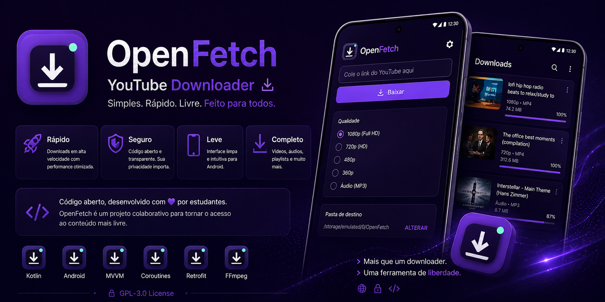

<div align="center">
  
</div>

# OpenFetch — versão 0.1.0 (alpha)

Gerenciador desktop de downloads para Windows 10/11. Projeto Wails v2 + Go com interface HTML, CSS e JavaScript sem dependências de frontend. Base pronta para evoluir depois para React/TypeScript.

## Já implementado no código

- Interface escura com páginas **Visão geral**, **Downloads**, **Conversor** e **Configurações**.
- Análise de URLs de mídia via `yt-dlp` (`--dump-single-json`) e reconhecimento de links diretos de arquivos.
- Download de vídeo MP4 priorizando H.264/AVC e AAC, com melhor qualidade disponível dentro do limite selecionado; não há transcodificação, e fontes sem formatos compatíveis são recusadas. Extração MP3 via `yt-dlp` + `FFmpeg`, com runtime JS `Deno` empacotado para melhorar suporte a sites que exigem processamento JavaScript.
- Seleção opcional de arquivo de cookies Netscape para análise e download do YouTube; a seleção dura apenas até fechar o aplicativo.
- Download de arquivos HTTP(S) com indicador de progresso, arquivo temporário, verificação do tamanho recebido e cancelamento.
- Novos downloads são organizados em subpastas **Vídeos**, **Áudios** e **Arquivos** dentro da pasta configurada; conversões MP4 e MP3 são salvas na pasta correspondente. Arquivos já existentes não são movidos.
- Fila de até 2 operações simultâneas, progresso de mídia, histórico local (JSON) e pasta configurável.
- Conversão local para MP3 ou MP4 via `FFmpeg`.
- Botão de abertura da pasta de downloads e persistência do histórico entre sessões.
- Não exige conta, anúncio ou serviço em nuvem para a interface.

## Importante: estado da entrega

Esta é uma **alpha inicial com código-fonte**, ainda **sem testes de funcionamento em uma máquina Windows**. O pacote ZIP não é um instalador Windows pronto. Você precisará compilá-lo, ou executar a automação CI em um repositório GitHub. Não considere a versão 1.0.0 entregue.

## Como experimentar a interface agora

Abra `frontend/dist/index.html` no navegador. É uma **prévia visual**, e os botões dependentes do backend não baixam arquivos nesse modo.

## Compilar no Windows (para quem vai desenvolver)

Requisitos: Windows 10/11 x64, Go 1.23+, internet, [Wails v2](https://wails.io), [Inno Setup 6](https://jrsoftware.org/isinfo.php) (opcional para instalador). O usuário final do instalador não precisará instalar Go, Python, FFmpeg nem Deno separadamente.

Na pasta do projeto, abra o PowerShell:

```powershell
powershell -ExecutionPolicy Bypass -File .\scripts\build-windows.ps1
```

O script:
1. instala o comando Wails v2.17.0 para o desenvolvedor e resolve as dependências Go;
2. compila `build/bin/OpenFetch.exe`;
3. busca os executáveis de `yt-dlp`, `FFmpeg` e `Deno` de suas origens oficiais (e verifica o SHA-256 de yt-dlp e Deno);
4. cria `release/OpenFetch-0.1.0-portable/`;
5. se o Inno Setup estiver instalado, gera `release/OpenFetch-Setup-0.1.0.exe`.

**Observação:** o Windows pode precisar do Microsoft Edge WebView2 Runtime. A compilação usa a opção `-webview2 embed` do Wails, que incorpora o bootstrapper e oferece instalar o runtime automaticamente quando ele estiver faltando (pode exigir conexão com a internet).

## Estrutura

- `main.go` — inicialização do aplicativo Wails.
- `state.go` — estado local, fila e histórico.
- `downloads.go` — downloads HTTP e de mídia.
- `probe.go` — inspeção de URLs e metadados.
- `converter.go` — conversor local.
- `helpers.go` — validação de links e utilitários.
- `frontend/dist` — interface entregue embutida no executável.
- `scripts/build-windows.ps1` — processo de build no Windows.
- `installer/OpenFetch.iss` — receita do instalador.

## Limitações conhecidas desta alpha

- Links com restrições, login, captcha, DRM, geobloqueio ou sites não suportados pelo yt-dlp podem falhar.
- A seleção H.264/AVC + AAC melhora a compatibilidade dos MP4s com players do Windows, mas a reprodução ainda pode depender dos codecs instalados e do player usado.
- Playlists, vídeos privados e integrações com navegador ainda não estão implementados.
- Downloads de arquivos comuns não têm retomada por HTTP Range nesta versão. Downloads incompletos são descartados.
- Apenas formatos MP3 e MP4 estão disponíveis para conversão, e o MP4 exige codecs presentes no FFmpeg usado.
- O cancelamento de download de mídia encerra o processo principal, mas processos filhos do FFmpeg podem exigir tratamento adicional no Windows.
- A indicação de progresso na conversão local é indeterminada.
- Não há mecanismo de atualização automática, testes de ponta a ponta, testes Windows ou assinatura digital nesta versão.
- O bootstrapper do WebView2 requer internet se o runtime não estiver instalado. Uma edição totalmente off-line exigirá empacotar o instalador completo do runtime.
- É necessário revisar as condições de uso dos sites e as licenças dos executáveis antes de distribuir publicamente.

## Segurança e privacidade

Somente URLs HTTP(S) são aceitas. Arquivos comuns são baixados para uma pasta com nomes higienizados; mídias são processadas pelo yt-dlp sem invocar um shell. Seu histórico é salvo em `%AppData%/OpenFetch/state.json`. URLs privadas e tokens em query string podem constar no histórico: evite compartilhá-lo.

Cookies do YouTube são opcionais e permanecem selecionados apenas durante a sessão atual. O OpenFetch valida o formato Netscape, copia somente cookies de domínios `youtube.com` para uma pasta temporária com permissões restritas e remove a cópia após cada operação; cópias antigas remanescentes de encerramentos inesperados são removidas na inicialização após 24 horas. O arquivo original não é alterado, e o caminho não é salvo em configurações, histórico ou logs. Cookies são credenciais de sessão: selecione apenas um arquivo exportado por você e remova a seleção ao terminar.

A licença e o plano de distribuição do OpenFetch ainda precisam de decisão. Consulte `docs/LICENCAS-E-CREDITOS.txt` antes de redistribuir compilados com FFmpeg, Deno e yt-dlp.
